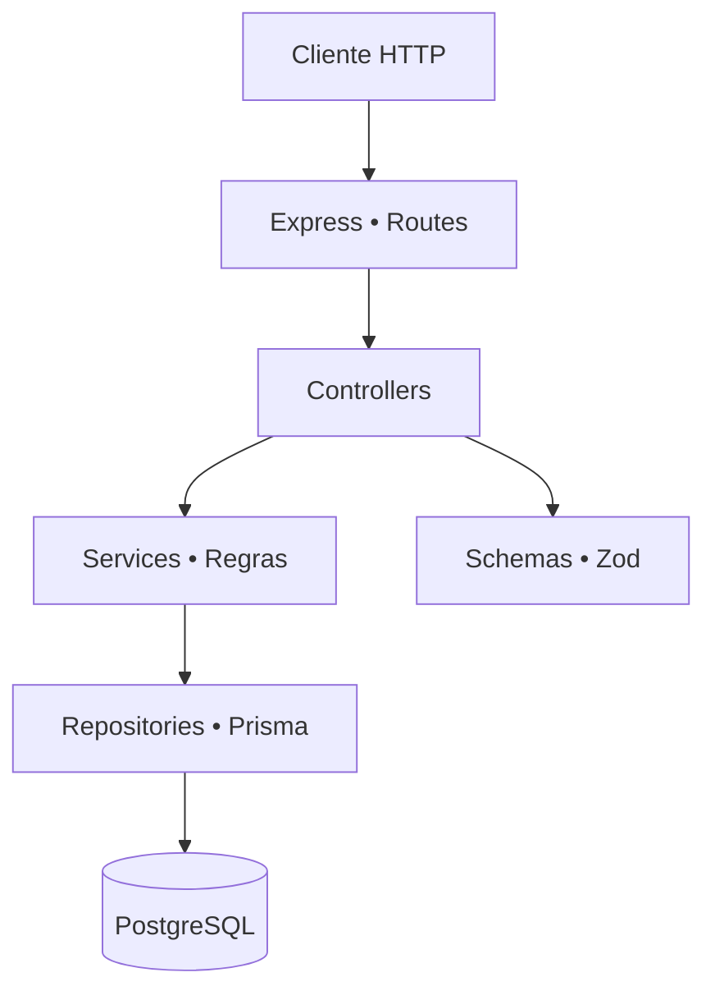

<div align="center">

# 🛒 E-commerce Backend API
### API REST para gerenciamento de produtos e categorias


</div>

## 🎯 Visão geral

API para **gestão de catálogo de produtos e categorias**, com TypeScript, Express, Prisma e PostgreSQL. Demonstra organização de backend em camadas, validação de entradas, regras de negócio, documentação OpenAPI e testes de integração com banco separado.

## ✨ Recursos

| Recurso | Comportamento |
|---|---|
| 📦 Produtos | Cadastro, consulta, alteração, remoção lógica e filtros |
| 🗂️ Categorias | Gestão e restrição de exclusão quando há produtos ativos |
| ✅ Validações | Dados validados com Zod; valores de preço e estoque consistentes |
| 🧾 Soft delete | Registros removidos logicamente são ocultados de consultas comuns |
| 🔎 Listagens | Paginação e filtros por atributos do catálogo |
| 🧪 Testes | Vitest/Supertest contra PostgreSQL de teste |
| 📚 API | Swagger/OpenAPI disponível durante a execução |

## 🏗️ Arquitetura



**Organização:** `src/modules/` contém o domínio, enquanto `src/middlewares/`, `src/errors/`, `src/database/` e `src/config/` centralizam infraestrutura e responsabilidades comuns.

## 🚀 Executar com Docker

Requer Docker e plugin Compose:

```bash
git clone https://github.com/WalterMatheusgg/ecomerce.git
cd ecomerce
cp .env.example .env
docker compose up --build
```

Configure os valores de `.env` de forma **local**. Por padrão, a documentação do projeto indica:

- API: http://localhost:3000
- Swagger: http://localhost:3000/docs/

Não execute `docker compose down -v` caso precise preservar os volumes.

## 🧪 Testes de integração

Os testes são configurados para um PostgreSQL separado do banco de desenvolvimento:

```bash
cp .env.test.example .env.test
docker compose up -d db-test
npm ci
npm run prisma:generate
npm run prisma:migrate:test
npm run test:integration
```

**Atenção:** revise as URLs em `.env` e `.env.test`. Execute a suíte somente contra banco de teste; a verificação automatizada do projeto recusa um destino inadequado.

## 📡 Endpoints principais

| Método | Rota | Finalidade |
|---|---|---|
| GET/POST | `/categories` | Listar e cadastrar categorias |
| GET/PUT/DELETE | `/categories/:id` | Consultar, alterar e remover |
| GET/POST | `/products` | Listar, filtrar e cadastrar produtos |
| GET/PUT/DELETE | `/products/:id` | Consultar, alterar e remover |

Exemplo:

```bash
curl -X POST http://localhost:3000/categories \
  -H 'Content-Type: application/json' \
  -d '{"name":"Eletrônicos"}'
```

## 🔒 Qualidade e operação

- Não versionar `.env` ou `.env.test` com credenciais.
- Manter banco de desenvolvimento e testes isolados.
- Validar build, migrações e suíte antes de implantar externamente.
- Documentação e estrutura não equivalem a homologação de produção.

## 👨‍💻 Autor

**Walter Matheus Soares da Silva** · [GitHub](https://github.com/WalterMatheusgg)  
Confira também o [NEXUS CRM — Java, Spring Boot e Angular](https://github.com/WalterMatheusgg/NEXUS).
